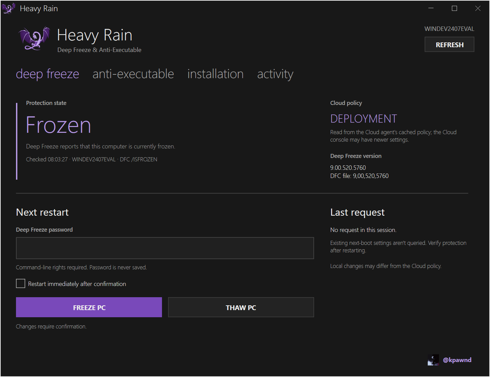
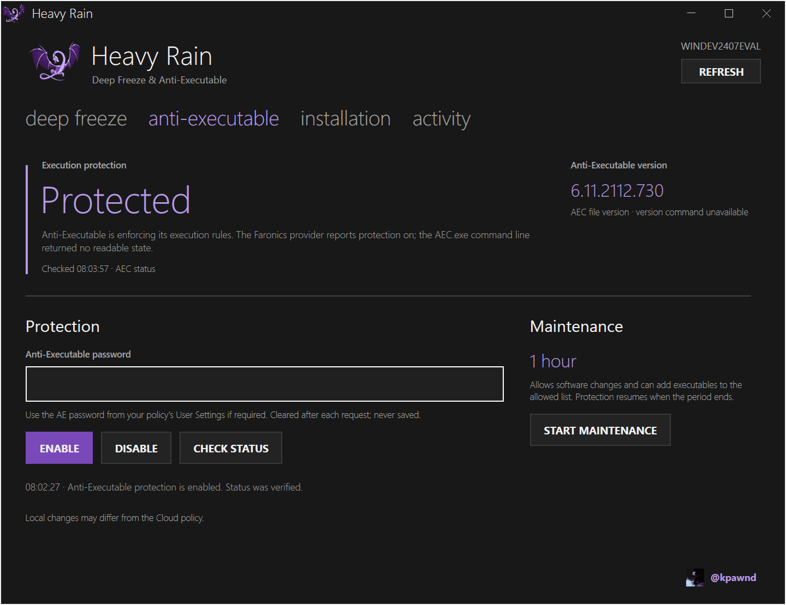

# Heavy Rain

A Windows app for Faronics Deep Freeze and Anti-Executable: check protection, freeze or thaw, and manage Anti-Executable. Built with C#, WPF and MahApps.Metro by [@kpawnd](https://github.com/kpawnd).





## Features

- Deep Freeze state, Cloud policy name, version and licence, refreshed every 30 seconds.
- Freeze or thaw on the next boot, or restart into the new state now.
- The change waiting for the next restart and how long the PC has been Thawed, from Deep Freeze's own records.
- Deep Freeze's schedules from the Cloud policy, and a history of boots, requests, restarts and Cloud tasks.
- A check of the Faronics drivers and services.
- Anti-Executable state, enable, disable and one-hour Maintenance.
- Anti-Executable's policy settings, and its recent activity with an option to allow a logged program.
- Diagnostic reports saved as JSON.
- An animated startup log, an original synth chime, and a dark purple Metro interface.

## Using it

Copy `HeavyRain.exe` anywhere and run it; approve the administrator prompt. It's a single portable EXE with nothing else to install. The main window shows states, settings and controls; when a state is **Unknown** the reason appears under it, and every check and request is recorded under **activity**.

`--silent` mutes the startup and error sounds. `--demo` uses sample data and runs no vendor commands.

### Deep Freeze

Needs Deep Freeze with a compatible `DFC.exe`; the Cloud agent alone isn't enough. Heavy Rain finds `DFC.exe` automatically, or use **Locate DFC.exe** under **installation**.

Enter a **Command Line** password from the Deep Freeze policy's Password tab, then choose **Thaw PC** or **Freeze PC**; only the change that applies to the current state is offered. It takes effect at the next restart unless you switch on **Restart immediately**.

A thaw lasts until you freeze the PC again: `DFC /THAWNEXTBOOT` has no restart count, and on Deep Freeze 9.00.520.5760 the PC stayed Thawed across several restarts. To thaw for a set number of restarts and refreeze automatically, use Deep Freeze's own dialog (**Ctrl+Alt+Shift+F6**, then **Boot Thawed on next** _n_ restarts). Freezing uses `/FREEZENEXTBOOT`. With **Restart immediately** on, Heavy Rain sets the next-boot state and then restarts Windows itself; it doesn't use DFC's restart commands, which keep DFC running while Windows restarts. The Workstation password used in Deep Freeze's own dialog, a Windows password and one-time passwords won't work, and `DFC.exe` doesn't work at all unless the policy defines a Command Line password. DFC reports a password it won't accept as a generic error 5. Restarting a frozen PC discards changes on protected drives, so save your work first.

**Pending** shows the latest boot-state change Deep Freeze recorded since Windows last started, from its events in the Application log (source "Deep Freeze", event 725), so it includes changes made in Deep Freeze's own dialog, by another tool or before Heavy Rain was opened. While Thawed, the state shows how long, back to the first boot of the current Thawed run; it turns amber after eight hours.

**Licence** comes from `DFC get /LICENSETYPE` and `get /LICENSESTATUS` and turns amber within 30 days of expiry. **Scheduled** lists the active workstation tasks and weekday schedules from the cached Cloud policy, with the next start, plus the Cloud agent's check-in interval; hover for what each one does. **activity → deep freeze** lists the last 30 days of Deep Freeze's boot records and requests, Windows restarts with what started them, and the tasks the Cloud sent, including failures. **installation → components** shows whether the Deep Freeze drivers, its service, the Cloud agent and the Anti-Executable engine are registered and running.

### Anti-Executable

Heavy Rain finds `AEC.exe` in the Faronics folders, or use **Locate AEC.exe**. Your Windows account must be authorized in Anti-Executable, and if the policy sets an AE password, enter it; it's separate from the Deep Freeze password.

**Enable**, **Disable** and **Start maintenance** ask for confirmation, send the command once, then check the state up to six times over ten seconds while it settles. Maintenance lasts one hour and can add new or changed programs to the allowed list; disabling during Maintenance ends it and leaves protection off.

**Policy** shows the settings saved on the PC, and **Your account** whether the cached Cloud policy lists your Windows account (or a group it's in) as an Anti-Executable administrator or trusted user. "Unknown programs can still run" means the policy allows and only logs unknown programs, even while protected. **activity → anti-executable log** lists the newest entries from Anti-Executable's own log. Select a program and choose **Allow selected file**; Heavy Rain asks you to confirm and for the AE password, then adds it to the allowed list. AEC doesn't report the list back, so this is shown as accepted, not verified. Hover over the list to see the log's path.

If the state shows:

- **Not authorized**: AEC treats your Windows account as an External User. Add it under **Anti-Executable → User Settings → Trusted Users** in the Cloud policy and check again. An AE password doesn't grant access on its own.
- **Password required** or **Password rejected**: enter the AE Administrator or Trusted User password named in the message, from the policy's **User Settings**, and choose **Check status**.

## Good to know

- Changes are local; a Cloud policy can apply different settings at its next check-in, and the Cloud console may have newer settings than the PC.
- Passwords are never saved, logged or exported, and are cleared after each request. The vendor tools receive them as process arguments, so command-line auditing may capture them.
- States come only from `DFC.exe`, `AEC.exe` and the Faronics provider; a registered agent or driver isn't treated as proof of protection. Unrecognized responses stay **Unknown**.
- On Anti-Executable 6.11.2112.730, `AEC.exe` reports "Unprotected" even while protected, so the state is cross-checked with the Faronics provider (`root\Faronics`, `AntiExecutable_v2`). Its codes `1105` (protected), `1102` (Maintenance) and `1101` (off) were each confirmed against Anti-Executable's log; other codes are left to `AEC.exe`.
- The Cloud policy name comes from the Cloud agent's cached `Tasks.dat`, with Faronics registry fields and the Cloud window as fallbacks. Hover over it to see the source.
- Installation and versions are rechecked every five minutes or on **Refresh**. Polling pauses while minimized.
- **Export diagnostics** includes checked locations, read errors, session activity, the Deep Freeze history, schedules and components, but not passwords, tokens, the raw policy cache, Cloud task bodies or Anti-Executable's log.
- From the Cloud agent's cache (`Tasks.dat`) Heavy Rain reads only task names, times and results, and from the policy only the check-in interval, the maintenance window, Deep Freeze's schedules and two of its flags, and Anti-Executable's user lists. Password, licence and task-body sections are never read.
- Workstation-task days come from the policy's day mask, read with Sunday as the first bit. This hasn't been confirmed against the Cloud console yet.
- The history relies on Windows keeping its event logs across Frozen restarts, which Deep Freeze does when the policy's **Persist event logs** setting is on. When it's off, Heavy Rain says so.
- Tested on a Cloud-managed Windows 11 VM with Deep Freeze 9.00.520.5760 and Anti-Executable 6.11.2112.730, including live freezes, thaws and Anti-Executable changes.

## Building

Requires Windows and the .NET 10 SDK.

```powershell
dotnet build HeavyRain.sln -c Release
dotnet run --project tests/HeavyRain.Tests -c Release
dotnet publish src/HeavyRain/HeavyRain.csproj -c Release -o publish
```

`publish/HeavyRain.exe` is the compressed single-file build. Add `-p:EnableCompressionInSingleFile=false` for a larger EXE that starts slightly faster.

## Credits

Heavy Rain is an independent project and doesn't include Faronics software. See the [DFC](https://docs.faronics.com/deep-freeze-cloud/using-deep-freeze-cloud-console/deep-freeze-service/advanced-settings-tab/deep-freeze-command-line-syntax) and [AEC](https://support.faronics.com/help/en-ca/46-anti-executable/216-what-is-the-command-line-syntax-for-faronics-anti-executable-enterprise) command-line documentation and the [third-party notices](THIRD-PARTY-NOTICES.txt). The purple dragon is a recoloring of the older [LLVM dragon](https://llvm.org/Logo.html), owned by Apple; Heavy Rain isn't affiliated with LLVM or Apple.
